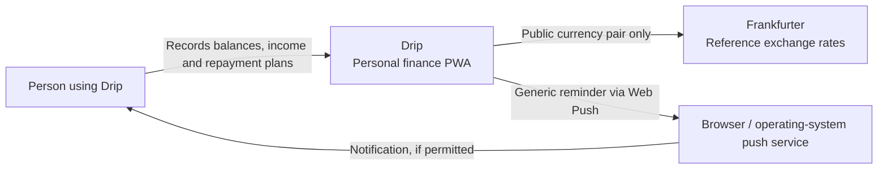
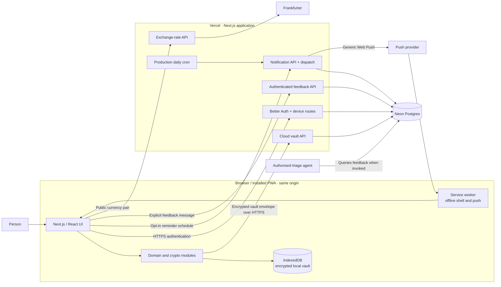
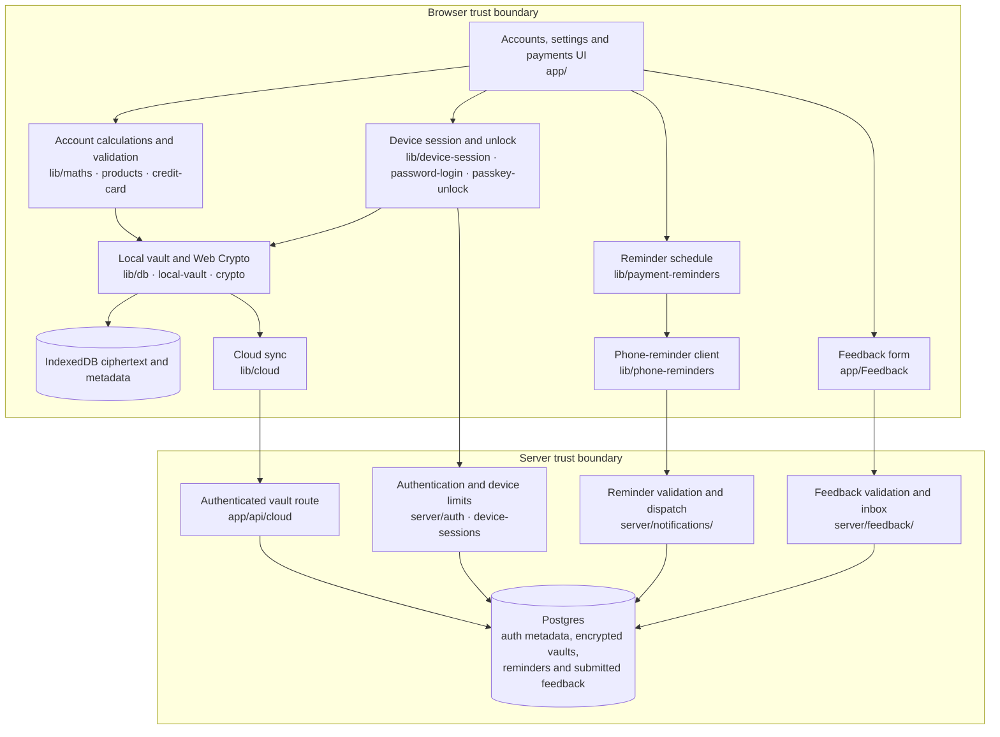

# Drip architecture

Drip is a local-first Next.js PWA. Financial data is encrypted in the browser; the backend stores encrypted cloud copies, authentication metadata and user-submitted feedback. This page describes the current implementation, not a proposed live market-price or bank integration.

## C4 level 1: system context

The user enters balances, yields, share prices and dates. Drip does not retrieve bank balances or live share prices, or make payments. Notifications depend on device support, permission and delivery; they do not confirm that a provider has paid.

## C4 level 2: containers

The app origin matters for browser storage, cookies and passkeys. Preview and Production use separate environments and secrets. Cron runs automatically in Production; Preview requires a controlled manual dispatch for testing.

## C4 level 3: components and trust boundaries

- **Keys and data:** the local vault uses AES-GCM encryption. Usable vault keys are held in page memory while unlocked; the server receives an encrypted cloud envelope, not the financial plaintext or recovery root. Authentication and reminder metadata remain server-side.
- **Sessions and devices:** Better Auth verifies cloud sessions. Drip limits active cloud sessions to four device profiles; local unlock and cloud authentication are separate. See [session policy](session-policy.md) and [device management](device-management.md).
- **Sync:** local data is the working copy. Cloud writes use version checks; conflicts are surfaced rather than merged automatically. A cloud restore contains only data that successfully synced.
- **Reminders:** schedule dates, frequencies and time zone leave the encrypted vault; push endpoints are encrypted at rest. Notifications omit account names and financial values. See [payment notifications](payment-notifications.md).
- **Feedback:** the user deliberately submits a message and chosen area. Feedback is not end-to-end encrypted and is readable by authorised reviewers; no account records are automatically attached. An authorised agent can query it when invoked. See [feedback and agent triage](feedback.md).
- **Compatibility:** encrypted data versions and the IndexedDB schema fence older writers when needed. Review [account workflows](account-workflows.md), migrations and old-to-new upgrade evidence before changing storage or recovery.

## Verification and deployment

Run the relevant tests and the full [regression gate](testing/regression-policy.md) for application changes. Use isolated databases and synthetic accounts for Preview tests. Production migrations and secrets are environment-specific; do not copy Preview data or secrets into Production. The app's live URL and release history are linked from the [README](../README.md).
