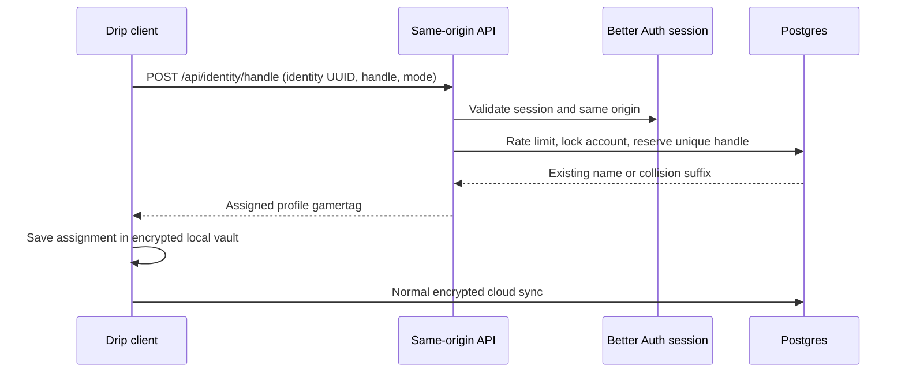

# Profile gamertag reservations (#13)

Status: implemented on `feature/13-gamertag-reservations`; Preview database first. Production migration is not part of this change.

## Product boundary

Drip has two distinct names. The sign-in gamertag belongs to password authentication. The profile gamertag is a display label carried in the encrypted vault and used around the app. This feature makes the display label unique across synced accounts. Changing it does not change sign-in credentials.

## Data and ownership

`scripts/migrate.mjs` adds `drip_handle_reservations` and `drip_handle_limits`. Each reservation associates a random local identity UUID with an authenticated Better Auth user. The active tag is unique case-insensitively; an optional four-digit suffix disambiguates collisions. The table contains profile labels and account IDs, not financial records. Financial account data remains in the encrypted vault.

Only the authenticated account can reserve or rename its active identity. Existing cloud accounts claim their current name on sync. Sync uses `ensure`: it creates a reservation if missing and returns the server's existing assignment, but it cannot rename a handle silently. The profile settings form uses `rename` explicitly. Other account/identity combinations receive a conflict response.

On rename, the previous tag stays reserved for 30 days. The owner can reclaim it during that period. Expired history is removed lazily during the next reservation. Reserved names are `admin`, `drip` and `support`, compared without regard to case. Changes are limited to 10 per account per hour; idempotent ensures allow 120 per account per hour. Requests also have an IP-based hourly limit using keyed hashes rather than stored IP addresses.

## Request flow

The database unique indexes arbitrate concurrent claims. User-level transaction locks serialize changes for one account; another user cannot take over an identity UUID. On a collision, the server retries generated four-digit suffixes under the same transaction.

## Deployment

The migration is additive and idempotent. The regression suite extracts and runs the actual migration SQL against a disposable local Postgres schema. For deployment, apply it to Preview first, verify the Preview signup, collision, rename, restore and sync paths, then include it in the normal application release migration. Do not point local tests or the initial release step at Production.
