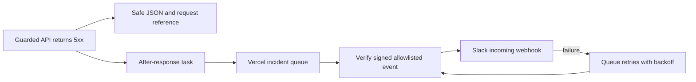

# Drip server incidents

Guarded auth, cloud, recovery and cloud-status routes can publish sanitized
**5xx** alerts to Nexus Slack **#incidents** (`C0CBL6RN3UZ`). Expected 4xx
responses, including wrong credentials, device limits and rate limits, do not page.

The queue is independent of Drip's auth/financial database. Vercel deployment
OIDC authenticates SDK operations. No agent is assigned or activated by this change.

## Safe errors and alert details

Each guarded response gets a generated `X-Drip-Request-Id`. Exceptions and returned
5xx responses become non-cacheable safe JSON without upstream bodies or partial
auth cookies. A process-local response identity preserves specific safe codes
constructed by Drip, including device-admission failures. An upstream header or
body cannot declare itself trusted. Success cookies and 4xx behavior are retained.

Alerts contain only app, environment, fixed operation, allowlisted route/method,
status, error category, time, validated commit/deployment IDs and generated
reference. Unknown auth paths become the catch-all route. There are no raw
exception messages/stacks, URL queries/fragments, request/response bodies,
cookies, gamertags, passwords, recovery material or financial data. Slack renders
the payload as plain text, not user-controlled markup.

The producer HMAC-signs a strict schema. The consumer checks signature,
environment and seven-day age limit before posting. Callback bodies are capped
at 8 KiB before SDK processing. Public callback headers/bodies cannot authorize
an alert. The webhook must use HTTPS on hooks.slack.com in the verified Nexus
workspace path, without redirects, query or fragment. Its Slack installation
must bind it to #incidents.

## Grouping, retries and limits

The queue idempotency key groups app/environment/operation/route/method/status/
category/release into five-minute buckets across instances. A different request
UUID does not create another issue. Repeats in the bucket are suppressed; counts
and a permanent incident thread are not maintained. A new bucket can post again.

Publishing retries once with the same signed event/key after an uncertain
acknowledgement. Next.js `after()` keeps publication and Slack latency out of the
original response. Failure before acceptance writes a sanitized
`incident_pipeline_failed` record; the queue cannot durably retry an event it
never accepted. A process crash before publication can lose that event.

Queued events remain retryable for seven days, with bounded exponential backoff
and Slack Retry-After handling. Failed notifications are never silently
acknowledged. Webhook requests time out after five seconds. Undelivered events
expire after retention. Operators must watch delivery-failure records, queue
age/expiry and usage. No independent delivery-failure pager is configured here.

Delivery is at least once. Slack acceptance followed by a lost acknowledgement
can create a duplicate on retry; there is no cross-system transaction. Platform
timeouts/build crashes and errors outside guarded routes need separate platform
monitoring. Browser console errors are not uploaded as server incidents.

## Configuration and activation

Delivery is off unless `DRIP_INCIDENTS_ENABLED=true`. Configure server-only values
in the existing Vercel team `devonte-amos-projects`, project `drip`:

| Variable | Purpose |
| --- | --- |
| `DRIP_INCIDENTS_ENABLED` | Explicit switch; start with branch-scoped Preview. |
| `DRIP_INCIDENT_SIGNING_SECRET` | A random 32-byte-or-stronger secret; separate Preview/Production values. |
| `DRIP_INCIDENT_SLACK_WEBHOOK_URL` | Incoming webhook bound to Nexus #incidents, stored as a Secret. |

Never use NEXT_PUBLIC_ variables, commit credentials or paste them in chat. Put
the webhook value directly into Vercel secret settings through the approved Slack
app installation. Do not copy another app's database credentials. Label Preview
alerts explicitly; use separate webhooks if operational isolation is needed.
Variables require a Git deployment before code receives them. Secret rotation
invalidates older signed events; drain the queue or design explicit key overlap.

vercel.json registers the drip-incidents consumer. Queues is public beta;
official pricing includes the first 1,000,000 queue API operations on Hobby.
Function execution uses existing compute limits. Verify current availability
before activation; no plan change is part of this work.

Before calling delivery active:

1. Complete current-head checks and review; configure approved Preview secrets.
2. Deploy through Vercel Git. Verify one controlled Preview 503 produces a real
   #incidents post with the same reference, then test grouping and retry.
3. Record Slack permalink, exact deployment/source, queue acceptance and consumer
   acknowledgement. Mocks and manual Slack connector posts do not prove this path.
4. Apply separately approved Production configuration, merge and release steps.

Morning agent pickup remains a separate automation: sanitized evidence, local
reproduction, tested Preview fix, maintainer control of Production.

## Verification scope

Tests cover thrown/returned 5xx, 4xx exclusion, safe codes/cookies, references,
error-inspection failure, strict signing/tamper/replay rejection, environment
separation, callback limits, webhook destination validation, Slack failures/rate
limits, queue retry keys and failed publication without changing the response.

The integration test exercises the actual auth boundary, deferred publisher and
consumer through a real local HTTP Slack fixture. Vercel's broker is a test double
and outgoing webhook HTTP is routed to localhost. It never contacts Slack or
establishes hosted queue availability. Running Next.js/API/browser checks use
synthetic data; no Production access is needed.

Sources: [Vercel Queues](https://vercel.com/docs/queues),
[pricing](https://vercel.com/docs/queues/pricing),
[Slack incoming webhooks](https://api.slack.com/messaging/webhooks),
[agreed framework](https://nexus-3pc3712.slack.com/archives/C0CBL6RN3UZ/p1792773544475659).
