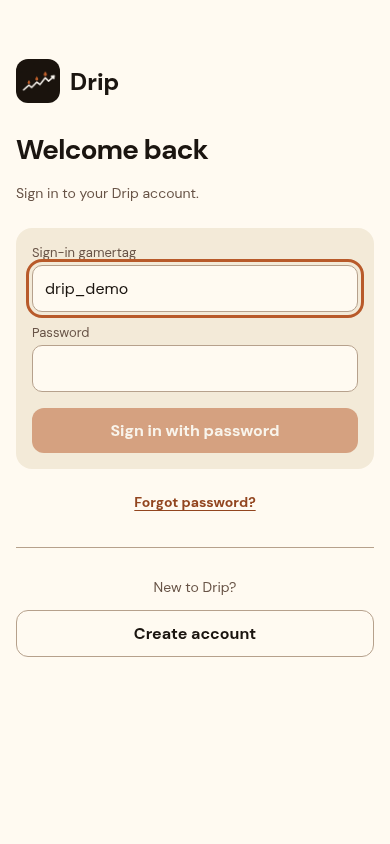
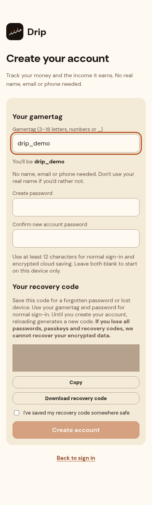
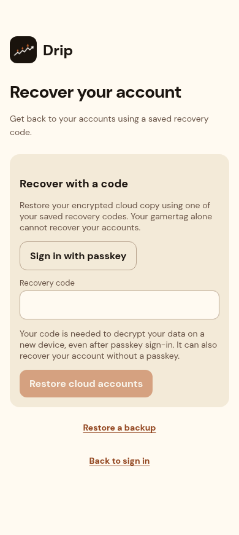

# Separate authentication screens

Captured 19 October 2026 from the running local Next.js production build at
`http://localhost:4321`. UI source commit: `e9810a2026035d13f4b52ebc06fa05602a51f257`,
PR #21. Later screenshot/documentation commits do not change this UI.

These are real implementation screenshots. `drip_demo` is synthetic; password
and recovery inputs are empty. Only the generated recovery-code element in the
signup images is visually masked. Signed-out examples use a synthetic local-only
account and wait for session sign-out confirmation. No customer records or cloud
accounts were created for these captures.

| Screen | Mobile, 390 × 844 | Desktop, 1280 × 900 |
| --- | --- | --- |
| Sign in | [Mobile](login-mobile.png) | [Desktop](login-desktop.png) |
| Create account | [Mobile](signup-mobile.png) | [Desktop](signup-desktop.png) |
| Recover a cloud account | [Mobile](recovery-mobile.png) | [Desktop](recovery-desktop.png) |

Additional mobile states: [signed out](signed-out-mobile.png),
[recover retained local accounts](local-recovery-mobile.png).
Full-page images include content below the viewport, especially signup.

Screenshots were opened and visually inspected. All three main screens were
checked at widths 320, 390 and 1280; no horizontal overflow was found.
See [layout checks](layout-checks.json). Browser tests verify separated forms,
history, focus, reload and cleared unsent passwords in addition to account flows.
This is local Chromium evidence; hosted Preview and physical iPhone behavior
remain unverified.

