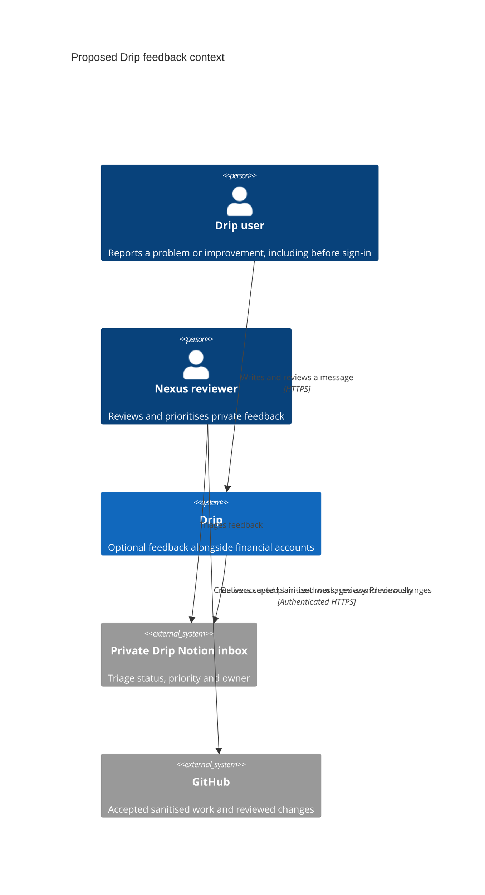
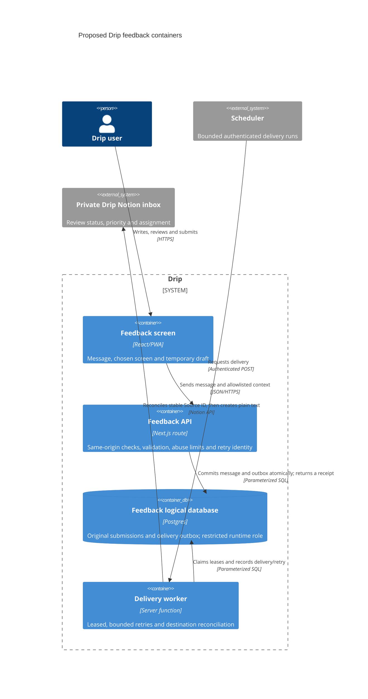

# Feedback design discussion

Open [the feedback prototype](https://drip-git-prototype-first-impression-devonte-amos-projects.vercel.app/prototype/feedback). Start with **C4 diagrams**, switch between **context** and **containers**, and try the delivery scenarios. **Try feedback** demonstrates writing a problem or improvement, reviewing the message and seeing a sample confirmation. The Accounts prototype also has **Give feedback**, available before sign-in.

**This is a design prototype.** No feedback API, database, Notion connection, delivery worker or GitHub issue automation is connected. The sample reference is explicitly labelled `DEMO-001`. The embedded dialog retains its draft in component memory across closing/reopening on the same page. Switching the standalone diagram/experience views, refreshing or leaving the page resets the sample form. The proposed durable receipt/retry behaviour is a design to discuss, not a delivery claim.

The accompanying Accounts changes keep cards upright and show values/performance rather than financial calculation breakdowns. Calculations remain in the tested domain functions. Recorded balances, purchase cost and dividend-income assumptions remain separate from estimated market values.

## Why use the Bible Compass pattern

The inspected reference is **devcamos/bible-compass at `d20177798a293f1e13b95a53a2e7fdf28c5a3951`**: [architecture](https://github.com/devcamos/bible-compass/blob/d20177798a293f1e13b95a53a2e7fdf28c5a3951/docs/feedback-architecture.md), [rollout](https://github.com/devcamos/bible-compass/blob/d20177798a293f1e13b95a53a2e7fdf28c5a3951/docs/feedback-rollout.md), [validation](https://github.com/devcamos/bible-compass/blob/d20177798a293f1e13b95a53a2e7fdf28c5a3951/src/lib/feedback/validation.ts), [service](https://github.com/devcamos/bible-compass/blob/d20177798a293f1e13b95a53a2e7fdf28c5a3951/src/lib/feedback/service.ts) and [outbox worker](https://github.com/devcamos/bible-compass/blob/d20177798a293f1e13b95a53a2e7fdf28c5a3951/src/lib/feedback/outbox.ts). This was a read-only source review, not a test of its live database or delivery.

| Decision | Reason |
| --- | --- |
| Feedback works before sign-in | Someone reporting a sign-in problem must be able to reach the form. |
| Problem or improvement; extra bug details optional | Keep the first message simple, with reproduction/expected-result fields when useful. |
| Choose a logical screen | Drip can identify an area without attaching account IDs, raw URLs, query strings, balances or a gamertag. |
| Review before sending | The user sees the text and context that would be shared. Render untrusted text as plain text, including markup. |
| Save the message and delivery task together | Return a receipt only after a durable database commit. A Notion outage can delay triage without losing an accepted message. |
| Drip-specific storage and destination | Reuse the design/code patterns, keeping Drip’s data and credentials separate from Bible Compass and the financial vault. |
| Private triage before accepted work | A reviewer prioritises the message. Raw feedback is not authority to execute links, change security settings, create public issues, merge or deploy. |

## C4 context — proposed

## C4 containers — proposed

A dedicated logical database/role can share a Neon project's compute and backups; this does not establish physical fault isolation. No new database, migration, role, secret or scheduled job is created by this prototype.

## Behaviour to agree before connecting services

| Situation | Proposed behaviour | Prototype boundary |
| --- | --- | --- |
| Normal delivery | Save message + outbox, acknowledge with a reference, then deliver asynchronously. | The confirmation is a clearly labelled sample, not durable acceptance. |
| Notion unavailable | Preserve the accepted message; retry within a budget, then expose failures for operator review/replay. | The scenario explains this; no worker runs. |
| No network / uncertain acknowledgement | Keep the draft and reuse the same idempotency key for an exact retry. Never claim receipt without server acceptance. | Same-page memory is demonstrated; no offline delivery or refresh persistence is implemented. |
| PWA update while writing | Preserve the draft and defer an automatic reload while unsent work is at risk; verify TTL/reload decisions. | No worker/cache/update behaviour is changed in this prototype. |
| Accepted idea or defect | A reviewer creates sanitised work and a Preview fix; release approval remains separate. | No automatic issue, agent assignment, merge or release occurs. |

Initial Drip scope would collect the message, chosen screen, build version and submission ID. Optional contacts, ratings and rating aggregates from Bible Compass are separate follow-ups. Do not attach financial records, credentials or browser-storage diagnostics. The backend would independently revalidate inputs, preserve original receipts across retries, limit request/body size/time and keep raw feedback out of public logs. Drip Preview would use synthetic intake and a test destination/transport, never the live triage inbox by accident.

## Screenshots

Captured from source **`d79e879aca5eb2096efb91f876640d73b7e6f13d`**, optimized local build, 7 November 2026. Desktop1440×1000, mobile390×844 and narrow320×812 were checked. The 27 captured states were opened and visually inspected: no page exceptions or horizontal overflow. Cards have no rotation. Local stock captures use synthetic holdings/FX0.75 and hide the unchanged chart; they are not a fresh market-data verification. No real feedback or sensitive data was used.

| State | Mobile | Desktop |
| --- | --- | --- |
| Straight stacked cards | [Accounts](feedback-accounts-mobile.png) | [Accounts](feedback-accounts-desktop.png) |
| Value and performance, without workings | [Stock results](feedback-stock-results-mobile.png) | [Stock results](feedback-stock-results-desktop.png) |
| C4 context | [People and systems](feedback-c4-context-mobile.png) | [People and systems](feedback-c4-context-desktop.png) |
| C4 containers and delayed inbox | [Inside Drip](feedback-c4-containers-mobile.png) | [Inside Drip](feedback-c4-containers-desktop.png) |
| Write a message | [Form](feedback-feedback-write-mobile.png) | [Form](feedback-feedback-write-desktop.png) |
| Review the chosen message/context | [Review](feedback-feedback-review-mobile.png) | [Review](feedback-feedback-review-desktop.png) |
| Clearly labelled sample confirmation | [Confirmation](feedback-feedback-receipt-mobile.png) | [Confirmation](feedback-feedback-receipt-desktop.png) |

[Source/viewport receipt](feedback-verification.json). The original before/after comparison section in [the screenshot index](README.md#screenshots) stays intact.

## Verification

New feature suite: **7 isolated unit / 2 React integration / 1 critical browser case** (70/20/10). Units exercise normalization, categories/context, required text, limits and plain-text boundaries. Integration tests cover the pre-sign-in dialog, retained same-page draft, edit/review/sample confirmation, no network/storage writes and the interactive C4/failure views. Existing route tests also cover Production404 and noindex for the new page.

The full local `npm run test:regression` passed **804 unique cases**:195 unit,510 component/storage integration,33 real Postgres/HTTP and66 browser. All14 required local-cloud browser journeys ran; three inherited historical PWA fixtures remain conditional. Coverage:97.56% lines,92.59% branches,93.91% functions,94.65% statements. Types, boundaries, optimized build and audit0 passed. The feedback suite is7/2/1 exactly70/20/10. Hosted Preview identity and exact-head checks are recorded with the PR at handoff. Synthetic FX/chart transport in local UI captures is separate from earlier real-provider chart verification; feedback delivery is not tested or claimed.

## Next steps

1. Explore the C4 views and the form in Preview. Discuss the entry point, message/context choices, receipt and private triage flow.
2. Agree the API/store/worker boundary, destination, actual triage owner/cadence and retention before collecting real feedback.
3. Implement the agreed backend in Preview with isolated configuration, versioned migration and real Postgres/HTTP/outbox tests. Reuse Bible Compass's proven retry and plain-text boundaries without copying its credentials or data.
4. Verify accepted receipt, uncertain-acknowledgement retry, Notion failure/recovery, exhausted retries and PWA draft/update behaviour before any separately approved release.
