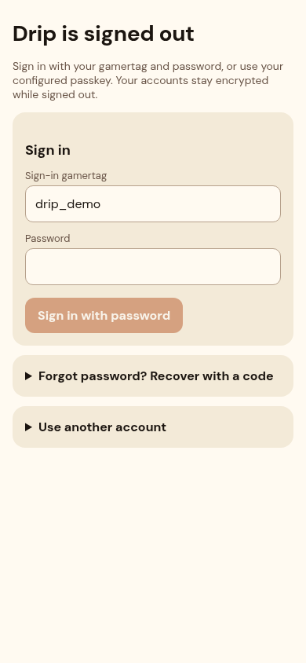
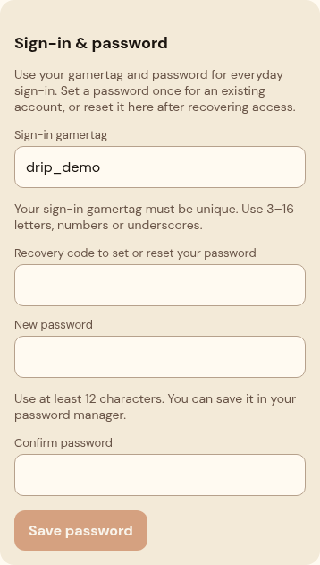

# Password sign-in UI evidence

Historical evidence: signup and navigation have since changed. See the
[current signup-to-Accounts gallery](../signup-to-accounts/README.md).

Captured 19 October 2026 from the running local Next.js production build at
`http://localhost:4321`, on `feat/gamertag-password` for PR #21. UI source commit:
`e362d9d045440f01c3246140b24165e446474f93`. Later server-only retry parsing fixes do
not change these screens. These are implementation screenshots, not mockups.

All data is synthetic (`drip_demo`). Password/recovery inputs are empty. The
generated test recovery code is visually masked only in the new-account capture.
The setup mobile image is cropped to its section; desktop images show the full
viewport. No hosted Preview or physical iPhone verification is implied.

| State | Viewport | Screenshot |
| --- | --- | --- |
| Normal sign-in, recovery collapsed | 390 × 844 | [Mobile sign-in](sign-in-mobile.png) |
| Normal sign-in, desktop layout | 1280 × 900 | [Desktop sign-in](sign-in-desktop.png) |
| Existing-account password setup/reset | 390 × 844, section crop | [Mobile setup](password-setup-mobile.png) |
| Recovery settings, desktop layout | 1280 × 1000 | [Desktop setup](password-setup-desktop.png) |
| Forgotten-password recovery expanded | 390 × 844, full page | [Mobile recovery](recovery-mobile.png) |
| New-account password fields | 390 × 844, section crop | [Create account](create-account-mobile.png) |

Each image was opened and visually inspected. Capture alignment was corrected so
the fixed navigation does not obscure the setup button. The changed screens were
checked at widths 320, 390 and 1280 CSS pixels: no horizontal page overflow.
See [layout results](layout-checks.json). Screenshots complement functional tests;
they do not establish authentication security or device compatibility by themselves.

