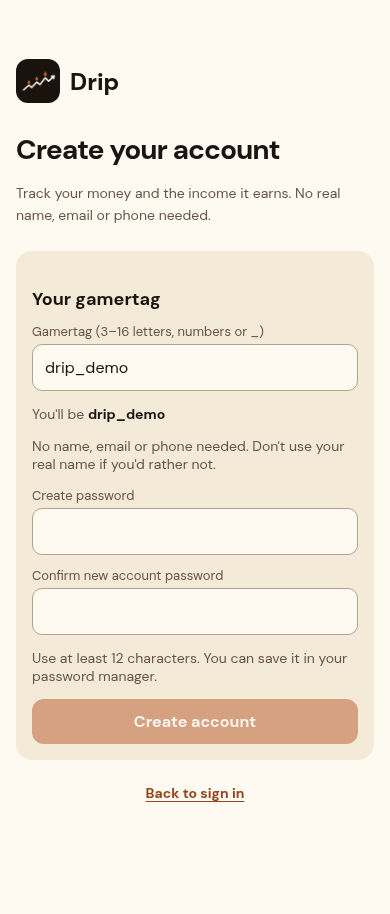
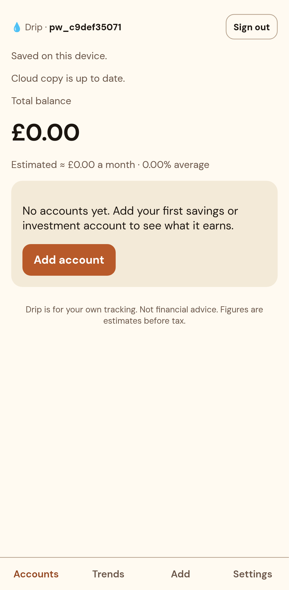
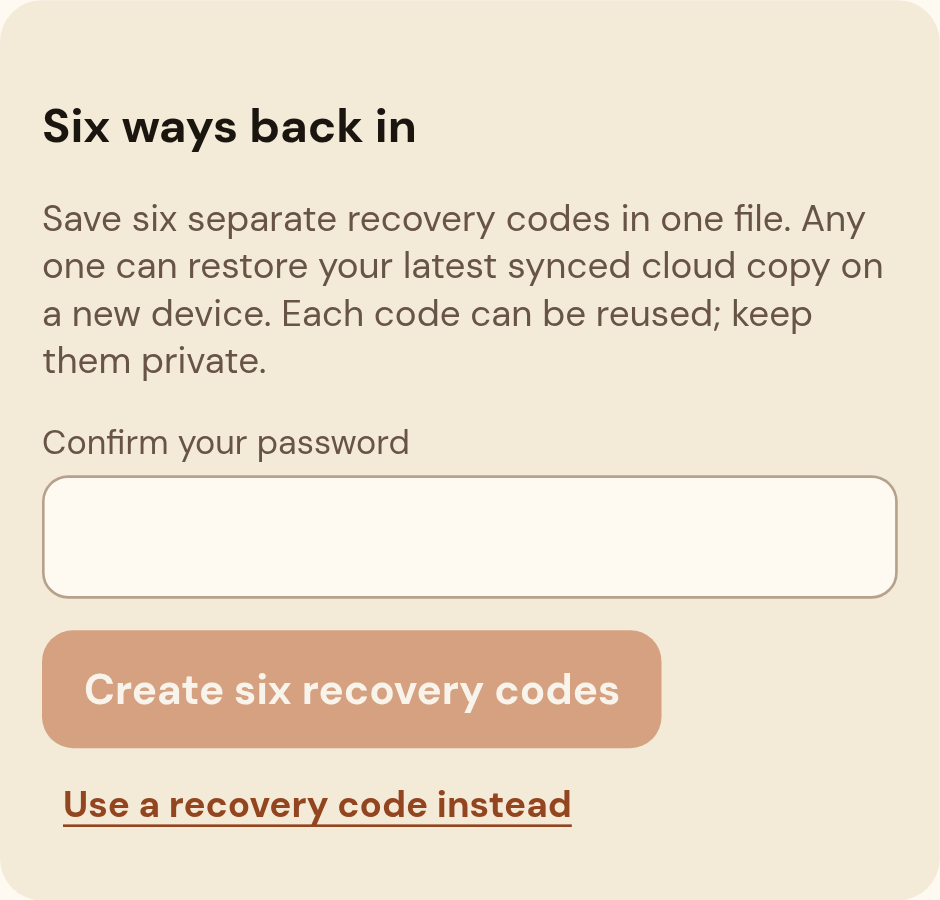

# Signup goes straight to Accounts

Captured 19 October 2026 from the running local Next.js production build at
`http://localhost:4321`, UI source `8f327644b037271e01a2bdbe601da18ee0463a65`,
PR #21. These are implementation screenshots, not mockups.

Signup now contains only gamertag and password fields, followed by Accounts after
successful registration. Recovery is a separate Forgot password screen. Optional
code setup lives in Settings and confirms the current password; it does not need
an earlier recovery code.

| State | Mobile | Desktop |
| --- | --- | --- |
| Signup, without a recovery-code step | [390 × 844 viewport](signup-mobile.png) | [1280 × 900 viewport](signup-desktop.png) |
| Accounts, immediately after real signup | [Mobile](accounts-mobile.png) | [1280 × 900 viewport](accounts-desktop.png) |
| Forgot password recovery | [390 × 844 viewport](recovery-mobile.png) | [1280 × 900 viewport](recovery-desktop.png) |
| Optional code setup in Settings | [390px viewport, section crop](code-setup-mobile.png) | — |

Signup/recovery use synthetic `drip_demo`, empty secret inputs and no submitted
signup. The Accounts/code-setup images come from the real cloud signup browser
test, using a random synthetic `pw_…` gamertag and an empty account list on the
isolated test database. No customer data is shown. Password fields are empty;
no recovery codes are visible. Pixel 7 browser-test images use its native device
pixel ratio, so their exported pixel sizes are larger than the CSS viewport.
Full-page images include content below the viewport.

All seven screenshots were opened and visually inspected. Signup and recovery
were checked at widths 320, 390 and 1280 with no horizontal overflow; see
[layout checks](layout-checks.json). The real signup test also verifies that
Accounts is selected, then generates and offers six downloadable codes after
password confirmation in Settings. Unit checks cover failed signup, retry,
wrong-password rejection and preservation of an account created in another tab.

This evidence is local Chromium with an isolated test backend. Hosted Preview
cloud setup and physical iPhone behavior remain unverified. Earlier galleries
show historical signup flows and are superseded by these captures.

